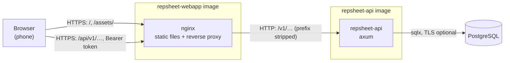
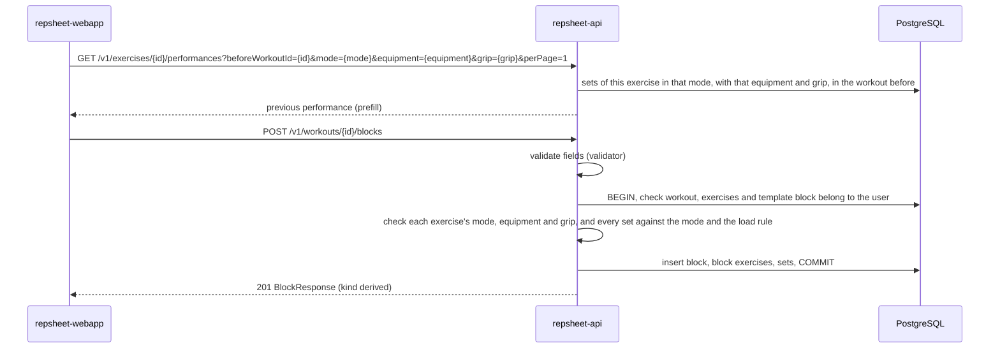
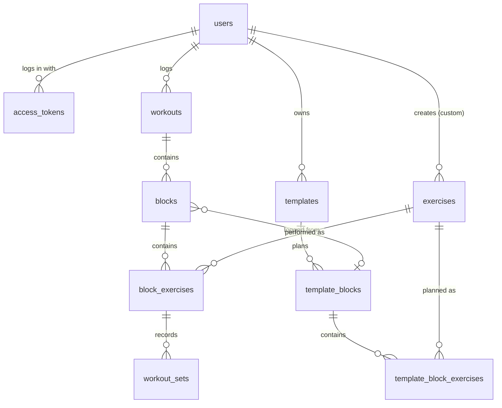

# Architecture

## Overview

RepSheet is a single-page web app backed by a JSON API and a PostgreSQL database. The browser loads
the static front end from nginx, which also forwards `/api/` to the API; the API is the only
component that talks to the database. Commands to build and run it are in the
[README](README.md#getting-started).

## Components

### `repsheet-api`

The Rust HTTP server in [repsheet-api/](repsheet-api/), built on `axum` with `aide` generating the
OpenAPI document from the handlers. It owns the database schema and applies its migrations
([repsheet-api/migrations/](repsheet-api/migrations/)) on start-up. It is layered so that each layer
only knows the one below:

- [`api`](repsheet-api/src/api.rs) — routes, request and response DTOs, field validation with
  `validator`, and the checks that need the database (an exercise belongs to the user, a set fits its
  exercise). DTOs are the only types serialised to the wire.
- [`domain`](repsheet-api/src/domain.rs) — the vocabulary: modes, load rules, equipment, grips,
  block kinds and the rules a set must follow for a mode and a load rule.
- [`db`](repsheet-api/src/db.rs) — one module per aggregate, running the SQL kept in
  [repsheet-api/queries/](repsheet-api/queries/).
- [`auth`](repsheet-api/src/auth.rs) — password hashing, bearer tokens, and the caller's role.
- [`bootstrap`](repsheet-api/src/bootstrap.rs) — the super admin account, upserted on start-up.

It serves `/openapi.json`, the Scalar reference at `/docs`, and `/healthz` for probes; the last two
stay out of the OpenAPI document.

### `repsheet-webapp`

The React and TypeScript client in [repsheet-webapp/](repsheet-webapp/), served as static files by
nginx ([repsheet-webapp/nginx/](repsheet-webapp/nginx/)). Every API response is parsed with `zod`
before use, so a contract mismatch fails loudly at the boundary. It keeps the bearer token in
`localStorage` and derives everything else from the API: the logging sheet's pre-filled values, the
planned blocks of a workout, the progression charts. It is an installable Progressive Web App:
a web app manifest and a Workbox service worker are generated at build time
([repsheet-webapp/pwa.config.ts](repsheet-webapp/pwa.config.ts)), and its PNG icons are rendered
from `public/logo.svg` during the same build.

### PostgreSQL

The single store. Nothing else holds state: the API is stateless and can run as several replicas.

## Data flow

Logging a block, the path that repeats for every block of a workout:

Creating or replacing a block, and creating or replacing a template, each run in one transaction:
a failed check leaves nothing behind. `PUT` replaces a block's exercises and sets wholesale, so a
retried request is harmless; `DELETE` answers `204` whether or not the resource still exists.

## State and persistence

- A **set** is one exercise in one round of a block: `round` orders the rounds, and the fields filled
  depend on the mode the block exercise is counted in (`block_exercises.mode`) and on the exercise's
  load rule. A superset's sets are therefore read round by round (A1, B1, A2, B2…), the order they
  are performed in.
- An **exercise** declares the `modes` it can be counted in (a non-empty set of `reps`, `time` and
  `distance`), a `default_mode` among them and a `load` rule (`none`, `optional` or `required`). It
  likewise declares the `equipment` it can be done with (a non-empty set of `barbell`, `dumbbell`,
  `kettlebell`, `machine`, `cable`, `bodyweight` and `other`) and a `default_equipment` among them,
  and the `grips` it can be held with (a possibly empty set of `pronation`, `supination`, `neutral`
  and `mixed`) with a `default_grip` among them, null exactly when there are none. Table checks keep
  each list a set and its default one of it. A block exercise records the `mode`, the `equipment`
  and the `grip` chosen for it, the grip null when it is not known; a template exercise records all
  three too, next to its target.
- **Exercises** with no owner form the built-in catalog, seeded by the migrations and visible to
  everyone; the others belong to the user who created them. Names are unique per user, built-ins
  included, compared through the SQL function `fold()` (lowercase, accents stripped), which also
  powers the search.
- A **workout** carries the day it took place on (`performed_on`) and an optional duration, not
  start and end times. Workouts are ordered by day, then by creation for a same day.
- An account has a **locale** (`fr` or `en`). A built-in exercise has a name in each language
  (`name_fr`, `name_en`); a custom one has at least the name its owner typed. The SQL function
  `exercise_name()` picks the name in the caller's locale and falls back on the other.
- An account has a **role**: `user`, or `super_admin` for the accounts that manage the others and the
  built-in catalog.
- Deleting a template keeps the workouts started from it: their `template_id` and their blocks'
  `template_block_id` become null.

## Design decisions

**The block kind is derived, never stored.** One exercise is a simple block, two a superset, three or
more a circuit. Storing it would allow a "superset" of one exercise; deriving it keeps one structure
for the three cases, and the client never asks the user to pick.

**The exercise says how it can be counted; each block picks one way.** A crunch is done for reps one
week and for a minute the next, a rowing machine for distance or for time. A single fixed measure per
exercise would split such an exercise into two catalog entries and its history with them. So an
exercise lists its modes and a default one, and each block exercise records the mode chosen for that
block: it applies to every round, since a column mixing reps and seconds could be neither summarised
nor compared. A set in `reps` mode needs `reps`, in `time` mode `durationSeconds`, in `distance` mode
`distanceMeters`, and the other two are rejected.

**The load is a rule of its own, not part of the mode.** Whether a set carries a weight does not
follow from how it is counted: a farmer's walk is a distance with a required load, a plank a time
with an optional one, a crunch takes none. `weightKg` is therefore required, optional (an extra load,
negative when assisted) or rejected according to the exercise's load rule, whatever the mode.

**The exercise says what it can be done with; each block picks one.** A bench press is the same
movement with a barbell or with dumbbells, and a coach switches between them from one week to the
next. Two catalog entries would split one movement's history and make the user pick between near
duplicates, so an exercise lists its equipment and a default one, and each block exercise records
the equipment used, exactly as it does its mode. A movement that differs, not just its equipment,
stays an exercise of its own: a one-arm dumbbell row is not a barbell row done with dumbbells. The
choice covers every round of the block, and only the load depends on it: the sets follow the same
rules whatever the equipment.

**The exercise says how it can be held; each block picks a grip, or none.** A pulldown is one
movement with the palms away, towards the body or facing each other, and the grip changes the load
much as the equipment does, so an exercise lists its grips and each block exercise records the one
held, exactly like its equipment: for every round, not set by set, since the rounds of a block are
the same movement repeated and a grip changing between them would split one block across curves. A squat or a plank has no grip to speak of: the
list is empty and the block records none. The grip is nullable where mode and equipment are not:
a block logged without one keeps it unknown rather than taking the default, since a guessed grip
would put a set on the wrong curve. Grip width is not modelled: a wide and a close grip stay the
same grip.

**Progress is compared within a mode, an equipment and a grip.** Performances can be filtered by
mode, by equipment and by grip, so "last time" and the pre-filled values of a block come from the
last block counted the same way and done with the same equipment and grip, and the client charts one
of each at a time: twenty reps and one minute never share a curve, and neither do 60 kg on a barbell
and 22 kg dumbbells, nor a supinated and a pronated row. The `grip` filter takes `none` for the
blocks with no grip recorded, which form a series of their own, while leaving it out lists every
grip. The history still lists every performance, each with its mode, its equipment and its grip.

**Weights are stored in kilograms.** The user's unit (`kg` or `lb`) is a display preference applied
by the client; history stays consistent if the preference changes.

**Templates hold targets, not weights.** A target is free text written from the coach's plan
(`6–8`, `max`, `1 min`), kept with the mode, the equipment and the grip it is done in, so a block
logged from it opens that way; a template exercise that plans no grip opens a block with none. The
weight comes from the user's history, which is what moves from one week
to the next. A workout block keeps a link to the template block it was logged from, which is how the
client knows which planned blocks remain; updating a template keeps a block's identity when the
request carries its `id`, so that link survives edits.

**Tokens are opaque and stored hashed.** A login returns 256 random bits; the database keeps their
SHA-256. Unlike a self-contained JWT, a token can be revoked (`DELETE /v1/tokens/current`) and
expires server-side, with no signing key to manage. The cost is one indexed lookup per request.

**Workouts are dated, not timed.** Most sessions are logged after the fact, sometimes days later and
out of order, so a workout records its day and an optional duration rather than timestamps taken
when the app was opened. "Last time" for a workout is the workout that precedes it in that order
(`beforeWorkoutId`), not the most recent one, so logging an old session late compares it against the
right one.

**The super admin comes from the configuration.** `SUPER_ADMIN_EMAIL` and `SUPER_ADMIN_PASSWORD`
are applied on every start-up: the account is created if missing, and otherwise gets that password
and the super admin role back. A deployment can therefore never lose its last administrator, and
rotating the password is a configuration change. Other super admins are promoted through the API;
none can demote or delete themselves.

**The language belongs to the account, and the API localizes exercise names.** The client sends the
detected language on sign-up and changes it through the preferences endpoint, so the phone and the
desktop agree. The API returns each exercise's name in that language, which keeps clients free of
catalog translations and makes the search match either language. One column per language is the
simplest model for two languages; supporting a third means a migration adding its column, not a new
table. Error responses stay in English: they are for developers, and the client translates them from
the problem `type` and the HTTP status.

**Built-in and custom exercises share one table and one API.** A super admin edits the catalog with
the same endpoints a user edits their own exercises with. Three rules protect history: a mode the
exercise was logged in cannot be removed from it (`409`, problem type `mode-locked`), nor can
equipment it was logged with (`409`, `equipment-locked`) or a grip it was held with (`409`,
`grip-locked`), and an exercise referenced by a workout or a template cannot be deleted. Template
exercises counted in a mode, or done with equipment or a grip, that is removed move to the new
default one, or to no grip when none is left, since a plan is not history. The load rule can change at any
time: it applies to the sets written from then on, including those of a logged block being edited.

**SQL lives in `.sql` files.** Queries are loaded with `include_str!`, so `sqlfluff` lints them like
the migrations and the Rust code reads as calls, not strings. They are checked at runtime rather than
by `sqlx`'s compile-time macros, so building needs no database.

**Two images.** The API ships as a static musl binary on a distroless image, with no shell and no
package manager; its health check runs the binary itself (`repsheet-api healthcheck`). The front end
is plain static files, so nginx serves them and proxies the API, which keeps both on one origin and
spares the API from CORS.

**The service worker caches the shell, never the data.** It precaches the built front end (HTML,
JS, CSS, fonts, icons), so the installed app starts without waiting on the network, and it routes no
request to `/api/`: API calls always reach the server, and a cached answer can never show a workout
that has since changed. Navigations to `/api/` and `/healthz` are excluded from the shell fallback,
so the service worker never answers them with `index.html`. Updates are automatic: a new service
worker activates as soon as it is installed, without a prompt, and the new front end takes effect at
the next launch rather than reloading a page that may hold an unsaved set. This only works because
nginx serves every unhashed file (`index.html`, `sw.js`, `registerSW.js`, the manifest) with
`Cache-Control: no-cache`; only the content-hashed `/assets/` are cached for good.

**The Helm chart deploys the application, not its database.** [charts/repsheet/](charts/repsheet/)
runs the two images as Deployments and only hands the API a `DATABASE_URL`. Backups, upgrades and
high availability of PostgreSQL belong to whatever operates it, a managed service or an operator; a
database bundled in the chart would tie its lifecycle to every upgrade of the application. The chart
carries its own version, and its `appVersion` names the release of the images it deploys.

## Invariants and constraints

- Every query on user data filters by the authenticated user. A resource owned by someone else
  answers `404`, never `403`, so its existence does not leak; `403` only answers a super-admin-only
  action attempted by a user.
- Every error response is an RFC 9457 problem document (`application/problem+json`) with a stable
  `type` URN; validation failures list the offending fields by their JSON path
  (`exercises[0].sets[2].reps`).
- A block or template exercise is counted in one of its exercise's modes, done with one of its
  equipment and held with one of its grips or none. No table check can see across the two tables:
  the API checks it on every write, and refusing to remove a logged mode, equipment or grip keeps it
  true afterwards. A block may hold the same exercise more than once, done differently.
- Every collection endpoint is paginated (`page`, `perPage` ≤ 100) and returns
  `{ items, page, perPage, total }`.
- A migration that has been applied is never edited: `sqlx` checksums them and refuses to start on
  a mismatch.
- Every API replica applies the migrations on start-up, under a PostgreSQL advisory lock taken by
  `sqlx`: replicas starting together apply them once, and the others wait, then find them applied.

## Limitations

- The client needs the network for data: the installed app opens offline, but shows no workout and
  cannot log one until the API is reachable again.
- There is no password reset and no email verification; an account is an email and a password.
- One weight unit per user, applied to every exercise.
- The exercise picker lists the first 50 matches of a search.
